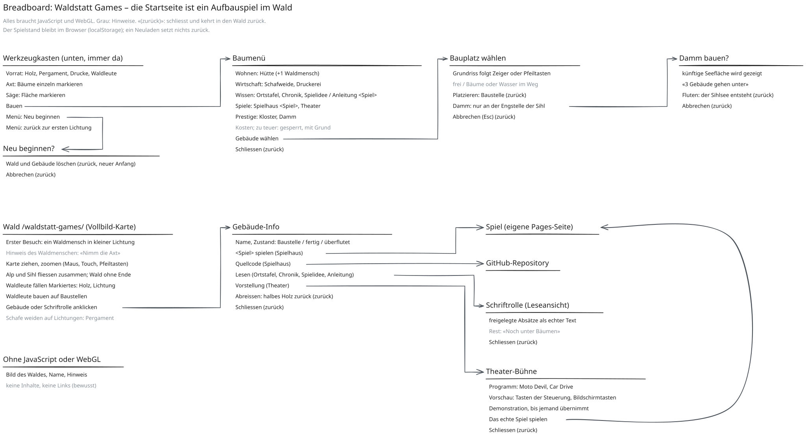
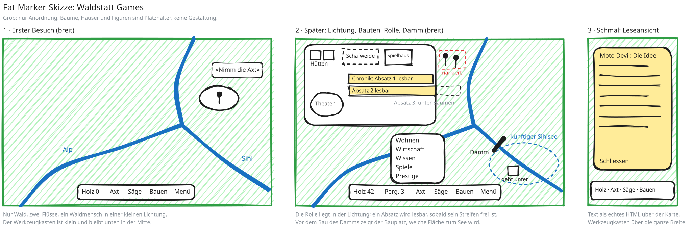

# Problem

The Waldstatt Games website is still its plain starting point: a home page,
an about page and a page per game, in a copy of daisyUI's forest colors.
Visitors see the name as a bare word, and it means little to anyone who does
not know its history.

«Waldstatt» is the historical name for Einsiedeln. Today's district of Einsiedeln
was once called the «Waldstatt Einsiedeln», and its people the «Waldleute». The
name holds a story that fits a game studio: a place that people carved out of a
dense forest.

The experiment: make the home page a small building game in which that
story happens to the visitor. The page opens on nothing but forest. Visitors fell
trees, build houses, and earn the site's content building by building. Everything
the site shows as pages, such as the studio's story, each game's idea and
controls, and the play and source links, is reached only by playing, and so are
new previews of the games.

The experiment succeeds when:

- a first-time visitor, on a desktop and on a phone, gets from the empty forest
  to a game's play link through play, in a few minutes and without
  instructions beyond the Waldmensch's first hint;
- every text and link that the site shows today can be unlocked;
- the forest stays as the visitor left it across reloads, and the page starts
  offline after the first visit.

# Solution

The home page `/` is a full-screen map of endless forest with two
rivers, the Alp and the Sihl, flowing together. A Waldmensch stands in a small
clearing. The only interface is a small toolbox at the bottom. Everything
happens inside `src/pages/` and `src/waldstatt/`.
The shared game texts stay as they are and are the source of the games' content.

**Amended during implementation.** The game follows the elements below with
these differences, recorded in the
[architecture documentation](../architecture/README.md#waldstatt-games):
Waldleute wade through rivers anywhere rather than at fords; PixiJS draws with
WebGL only, not WebGPU; the Ortstafel is a signpost rather than a scroll; the
Anleitung is a notice board that can stand anywhere, not only beside its
Spielhaus; and the printing press turns parchment into prints on its own, up to
a stock limit. The app icons are pixel art encoded as PNG at build time.

**Amended after the first version**, at the studio's request:

- The map is an isometric view with painted, shaded art instead of top-down
  pixel art.
- Everything is read and used on the map, not in dialogs: scroll texts lie on
  their scrolls, signs and printed notices stand by their buildings, and the
  theatre's stage is playable in place. Far out only names show.
- Buildings, scrolls included, stand only on cleared ground; scrolls no longer
  unroll into the forest, but are as long as their text needs.
- The waters are real, from swisstopo and BAFU data: the Alp, the Sihl and the
  rivers and lakes around them, from the Zürichsee to the Ägerisee. The Sihlsee
  did not exist before its dam, so it stays a basin until the game's dam floods
  it.
- Tearing down is a tool in the toolbox, and the build menu keeps its scroll
  position.
- Texts, plates and the stage lie flat on the ground and take as much space as
  their text. Tapping one turns the view into a top-down plan with north up, to
  read it or play on the stage; zooming out turns it back. Nothing on the map
  opens a panel or dialog: other buildings show a short status label, tearing
  down takes a second tap, and the dam names what will drown while placing.
- In the plan view, buildings, trees and Waldleute are drawn from straight
  above; the map can be dragged and zoomed in, and zooming out returns to the
  isometric view.
- The theatre is a wooden amphitheatre with stands all round, and its stage is
  painted on the map: the preview with wooden signs for the programme and the
  keys, played by tapping the signs or with the keyboard.

This is a hobby project, so the pitch sets no appetite. The game should still
grow in playable slices, each a sensible place to stop: forest, felling and huts;
then the Spielhaus, so play links can be reached; then parchment, scrolls and the
printing press; then the theatre; and last the monastery and the dam.

The breadboard shows the places, what visitors can do there, and where it leads.
Every place needs JavaScript and WebGL.

The fat-marker sketch shows the rough arrangement at the first visit, later with
a clearing, buildings, a half-unrolled scroll and a planned dam, and the reading
view at phone width.

Editable sources: [breadboard](pitch--aufbauspiel-im-wald.breadboard.excalidraw)
and [fat-marker sketch](pitch--aufbauspiel-im-wald.fat-marker.excalidraw).

## Elements

1. **The forest map.** An endless forest, generated in chunks from a fixed seed,
   so every visitor starts in the same forest and only their changes need
   saving. The Alp and the Sihl are fixed curves that flow together near the
   start. Upstream on the Sihl lie a narrow spot for a dam and the basin it
   would flood. Visitors drag or use the arrow keys to pan, and zoom within
   limits with the wheel or a pinch. A toolbox button brings the view back to
   the first clearing. The forest is the only thing to see, as dense as the
   forest maps of real-time strategy games, in an original top-down style.
2. **Waldleute.** On the first visit, one Waldmensch stands in a small clearing
   near the confluence and says «Nimm die Axt». Waldleute walk to the nearest
   tree marked for felling, fell it, and the wood counts at once; then they go
   to building sites and build. Each hut adds one Waldmensch, up to a fixed
   cap. They walk in straight lines, cross rivers at fords and need no
   pathfinding.
3. **The toolbox.** A small bar of real HTML buttons at the bottom, full width
   on phones. It holds the supplies (wood, parchment, prints, Waldleute) and
   the tools: the **axe** marks single trees, and the **saw** marks every tree
   in a dragged area. **Bauen** opens the build menu, and **Menü** holds
   recentring and «Neu beginnen», which asks for confirmation and deletes only
   the Waldstatt's saved state.
4. **Build menu and building sites.** Buildings are grouped as Wohnen,
   Wirtschaft, Wissen, Spiele and Prestige. Each shows its costs; one the
   visitor cannot afford yet stays visible, disabled, with the reason. A chosen
   building's footprint follows the pointer or the arrow keys and shows whether
   trees or water are in the way. Trees in the way are marked for felling, and
   placing a building pays its costs and starts a building site. Content
   buildings are one of a kind; huts and pastures can repeat. «Abreissen»
   returns half the wood.
5. **Resource chain.**
   - **Holz** from felling.
   - **Pergament** from a **Schafweide**, which needs cleared land. Its sheep
     produce parchment slowly while the page is open, up to a stock limit.
   - **Drucke** from the **Druckerei**, which turns parchment into prints.

   All costs and rates live in one table, so balance can be tuned in one place.
6. **Content as scrolls that need space.** A text is a parchment scroll laid on
   the map. Each section of its Markdown (each `##` heading) is one strip, as
   long as the section's text. Laying a scroll costs parchment and needs only
   its head cleared. The rest unrolls into the forest as the Waldleute clear
   it, because its strips are marked for felling, and a section becomes
   readable once its strip lies free. On the map, a strip shows only its
   heading and ruled lines. Clicking the scroll opens the **reading view**, a
   parchment panel of real HTML with the uncovered sections; the rest reads
   «Noch unter Bäumen». The texts come from the build: Astro renders them into
   inert `<template>` elements on the page, and the script copies the uncovered
   sections into the reading view.
   - **Ortstafel** (wood only, the first content): the name, and what
     «Waldstatt» and «Waldleute» mean.
   - **Chronik** (handwritten, parchment): the about texts: how it began, how
     we work, what we build with.
   - **Spielidee <Spiel>** (handwritten, parchment): the game's idea, what to
     expect and what matters.
   - **Anleitung <Spiel>** (printed, prints): the controls table, as a printed
     notice beside the game's Spielhaus.
7. **Games as buildings.** A **Spielhaus** per game, cheap enough to be the
   first goal after a few huts. Its building info offers «<Spiel> spielen»
   (`playUrl`) and «Quellcode» (`sourceUrl`). A game added to the shared texts
   gets a Spielhaus, a Spielidee and an Anleitung with a generic look.
8. **The theatre.** A larger building, available once a Spielhaus stands. Its
   «Vorstellung» opens the stage, which shows previews of the games whose
   Spielhaus stands. The previews are small simulations with simplified rules
   from each game's text, like the previews on the studio website. Their rule
   sets are copied into the Waldstatt and redrawn, never imported. A demonstration plays until somebody presses a key from the
   controls table or an on-screen key. «Das echte Spiel spielen» links to the
   game.
9. **Prestige buildings.**
   - **Kloster Einsiedeln**: very expensive, with a large footprint, and pure
     prestige. A simplified, recognisable building without religious symbols.
   - **Damm**: can only be built at the narrow spot on the Sihl. While placing
     it, the map shows the basin that will become the **Sihlsee**, and a
     confirmation names the buildings that will drown. Flooding is final until
     «Neu beginnen». Trees in the basin disappear under water, and drowned
     buildings stay as ruins under the surface with the state «überflutet».
     Their content is locked again and their costs are lost, but they can be
     built anew elsewhere.
10. **Saved state.** One versioned JSON document in `localStorage` under the key
    `waldstatt-games/save`. It holds felled trees as a bitset per chunk,
    buildings with their position and state, supplies, Waldleute and the
    camera. Which sections are uncovered is derived from the cleared tiles, not
    stored, so a changed text needs no migration. The game saves a few seconds
    after each change and when the tab is hidden. Production pauses in hidden
    tabs; there is no progress while the page is closed.
11. **Installable and offline (PWA).** A web manifest and a hand-written service
    worker, both generated by endpoints in `src/pages/`, so
    their URLs and scope honour the base path. The worker caches the site's
    built files under a
    cache named after the build, fetches the page network-first, and serves
    the hashed assets from the cache. It never handles requests outside its
    scope, such as the games.
12. **Rendering.** [PixiJS](https://pixijs.com/) 8 (WebGL 2D, with WebGPU where
    it is available) draws the map, trees, rivers, Waldleute and buildings.
    Trees are sprites from one generated texture atlas, batched per chunk, and
    chunks far off screen are destroyed. The
    sprites are pixel grids in code, turned into textures at startup. The
    toolbox, menus, building info, reading view and theatre are HTML over the
    canvas, styled by the site's daisyUI theme. The stage runs its previews
    on its own Canvas 2D, like the previews they come from.
13. **Without JavaScript or WebGL.** A still picture of the forest, the name, and
    the note that the Waldstatt needs JavaScript and WebGL. There are no texts
    and no links, by decision.
14. **Removed pages.** `/ueber-uns/` and
    `/spiele/<spiel>/` are deleted. The tagline in `meta.ts` changes to
    fit the game.
15. **Recorded decisions.**
    [ADR 0002](../architecture/decisions/0002-make-the-waldstatt-a-browser-game.md)
    (proposed) records the departures from ADR 0001: content that depends on
    JavaScript and WebGL, `localStorage`, a service worker, and a rendering
    library. The
    [architecture documentation](../architecture/README.md) describes the
    game and its missing routes once it is built.

### Why PixiJS

The map is 2D, top-down, and holds thousands of sprites; the texts must stay
real HTML, so they can be selected and read aloud. These were the options:

- **Canvas 2D, no library**, as the studio website's previews do. It adds no
  dependency, but needs hand-written batching and caching for an endless,
  changing forest.
- **PixiJS**, the choice. It batches sprites on the GPU and handles culling and
  textures for tens of thousands of trees; it costs one dependency and a few
  hundred kilobytes on this page only.
- **Babylon.js** is a 3D engine; nothing here needs 3D.
- **Bevy compiled to WebAssembly**, the games' engine, which the team knows.
  It would mean megabytes of download and a slow start for a home page, a Rust
  toolchain in this repository's CI, and texts drawn on a canvas that browsers
  cannot select or read aloud, unless bridged back to HTML. It fits the games,
  not a website's front page.

# Security

- **Saved state is untrusted input.** Anyone can edit `localStorage`, and the
  games and other pages on the same origin share it. The save is parsed as
  JSON, validated against its schema version and size limits, and discarded
  with a notice if it is invalid. No saved value is ever inserted as HTML.
- **Shared origin.** Every Pages site of the organization shares one origin,
  and with it `localStorage`; the games already save under `moto-devil/` and
  `car-drive/`. The Waldstatt uses only keys starting with `waldstatt-games/`,
  and «Neu beginnen» removes only those, never `localStorage.clear()`.
- **Service worker.** Same-origin, scoped to the base path, and serving
  only files from this build. A worker on a shared origin could intercept other
  pages within its scope, so its scope must never be wider than the site's
  path, and it caches no responses from outside it.
- **Content.** The texts are rendered at build time from the repository's
  Markdown into `<template>` elements; the script clones those nodes and sets no
  HTML from strings. The play and source links come from the content schema,
  not from saved state.
- **Third parties.** PixiJS is bundled from npm and served from the site.
  Nothing loads from a CDN, font service or analytics, and the game sends no
  requests other than for its own files.

# Rabbit Holes

- **A real strategy game.** Pathfinding, carrying goods, stockpiles, enemies,
  research trees or day and night would each swallow the work. Waldleute walk
  in straight lines, felled wood counts at once, and there is nothing to fight.
- **Tedium.** Clearing space for long texts by hand could bore people before
  they reach a play link. Keep the Spielhaus cheap, let the saw clear areas,
  let huts add Waldleute, and tune the costs in the one table by playing the
  path to the first play link on a phone. If the path still takes too long,
  lower the costs; do not add a skip button.
- **Endless forest, finite memory.** Generate chunks on demand, destroy them
  off screen, and save only the changes. Cap the number of Waldleute and
  buildings, and keep an eye on the save's size; warn without losing the
  current session if a save fails.
- **Text on the map.** Scaled text on a WebGL map blurs and is not accessible.
  Strips show only their heading and ruled lines; reading happens in the HTML
  reading view.
- **Changing texts.** The scroll's length follows the current text. When a
  game's text changes, sections are matched by heading. A new or longer section
  extends the scroll into the forest; no saved state needs migrating.
- **Flooding.** The basin is fixed, part of the generated map, and never
  computed from the visitor's clearings. Make the loss clear before
  confirming, and keep drowned buildings visible as ruins under the water so it
  does not feel like a bug.
- **Stale offline copies.** A cached old version must not hide a new build
  forever. Name the cache after the build, fetch the page network-first, and
  delete old caches when the new worker activates. Test an update by deploying
  twice.
- **Install requirements.** Browsers expect icons in fixed sizes. Generate them
  from the game's pixel art at build time, and check installation in at least
  one Chromium browser and on a phone.
- **Same-origin neighbours.** See Security: key prefix, narrow scope.
- **Too close to a real game.** The dense forest is a general idea, and the art
  is original. Use no names, maps, graphics, units, interface or sounds from
  Age of Empires or any other title, and do not name such games on the site.
- **Previews that grow into games.** Copy the existing preview rule sets, redraw
  them, and keep them as warm-ups: no levels, saving or scores.
- **History.** Write the texts about «Waldstatt», «Waldleute», the monastery and
  the Sihlsee from sources, not memory. When the Sihlsee was dammed, people lost
  their homes and farms. The dam is part of the story, so keep the texts around
  it respectful and make no jokes about drowning.
- **Accessibility, accepted limits.** The strict content gate shuts out search
  engines and makes the content hard to reach with a screen reader. That is the
  experiment's choice, recorded in ADR 0002. Still: every tool, menu and dialog
  is a real button with a German name and visible focus; the map takes the
  keyboard (arrow keys move a cursor tile, Enter applies the tool); status,
  supplies and the Waldmensch's hints are announced politely; the reading view
  is real text with managed focus. With reduced motion requested, Waldleute and
  water stand still, and work completes without animation.
- **Performance on phones.** Cap the pixel density, limit the zoom-out so that
  only a bounded number of chunks is visible, pause rendering in hidden tabs,
  and measure the bundle size and the start-up time on a mid-range phone.
- **No WebGL.** Some browsers or settings lack it. Then the still picture and
  the note remain (element 13).

# No-Gos

- No plain-text fallback, no static content pages, and no `<noscript>` links.
  The content is reached through play.
- No server, accounts, synchronisation between devices, save export or import,
  multiplayer or analytics.
- No combat, enemies, opponents, trading, research tree, seasons or regrowing
  trees.
- No progress while the page is closed.
- No embedding of the real games, and no game builds or assets; previews are
  simulations, and the play links lead to the games' own sites.
- No Bevy/WebAssembly, Babylon.js or client-side framework.
- No music or sound effects.
- No recreation of a particular game's look, names, interface or sounds.
- No changes outside `src/pages/` and `src/waldstatt/`, except the PixiJS
  dependency, the architecture documentation and ADR 0002. The shared game texts
  stay as they are.
- No logo or final brand identity.
