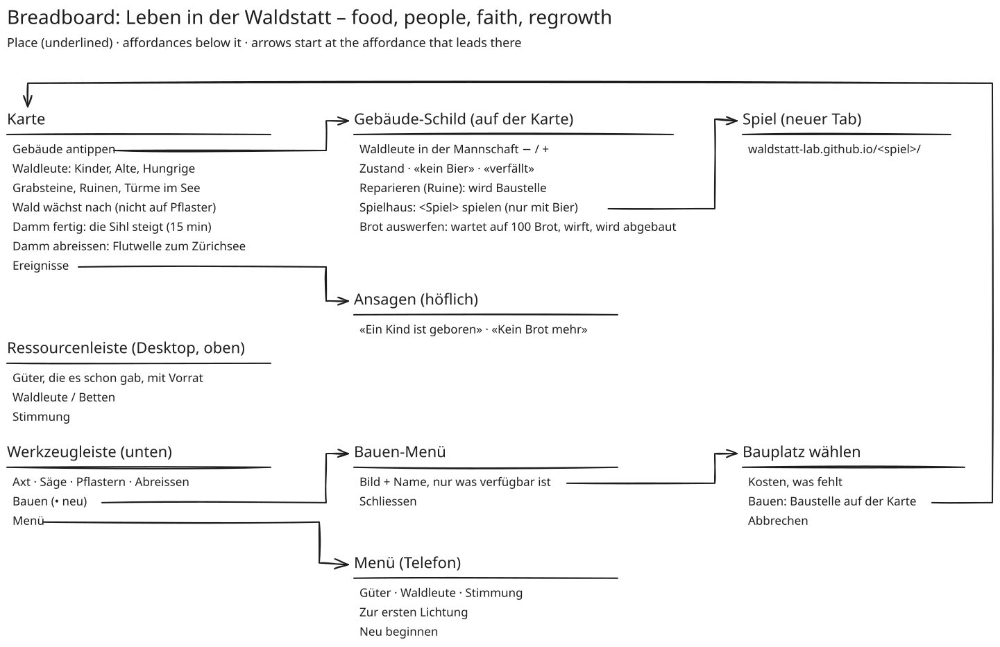
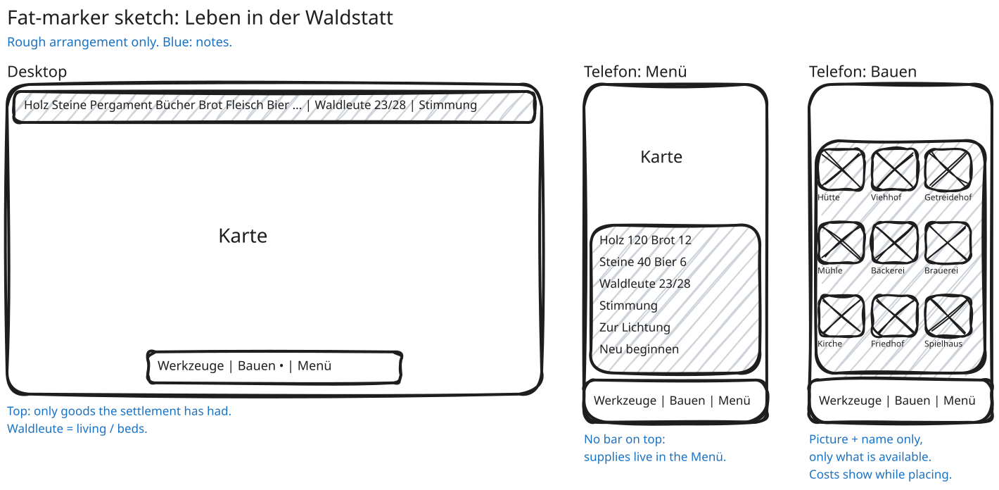

# Problem

The [first pitch](pitch--aufbauspiel-im-wald.md) turned the Waldstatt Games
website into a building game, and it is built. It is a game about clearing:
Waldleute fell, build and find the hidden texts, but they do not live. They need
nothing, never die, and do not grow in number beyond one per hut, up to 16.
Wood, parchment, stones and books are the only supplies, and every workshop
works as soon as somebody is put in it. Once the forest round the first clearing
is open, nothing is at stake, and the Waldmensch's hints say what to do next at
every step.

The studio wants the Waldstatt to become a settlement that has to be kept alive:
food from farms, a mill and a bakery, beer from a brewery, people who are born,
grow old and die, churches and graveyards, a mood that speeds work up or slows
it down, and a forest that grows back. Visitors should find all of this out by
playing, without hints. More goods also need a place on screen, and the build
menu should show only what can be built.

This changes what the Waldstatt is. Until now it was a gate to the site's content
that anybody could pass in a few minutes. Now it is a game that can be lost: the
colony can die out, and a game's play link needs a brewery and so a settlement of
at least 20 Waldleute. The studio accepts that some visitors will never reach a
play link (see [ADR 0002](../architecture/decisions/0002-make-the-waldstatt-a-browser-game.md)'s
consequences, which this pitch extends).

The rework succeeds when:

- a settlement can grow from the first pair to more than 100 Waldleute and stay
  fed, on a desktop and on a phone, without the page stuttering;
- every building can be found and understood by playing: nothing explains it,
  but what each building needs and does shows on the map;
- a colony that dies out does so for reasons a visitor can see coming: hunger,
  age, overcrowding;
- every text and link can still be reached through play;
- the settlement, its people and where each of them stands are as the visitor
  left them across reloads.

# Solution

Everything stays in `src/pages/` and
`src/waldstatt/`. This is a hobby project, so the pitch sets no
appetite. It should grow in playable slices, each a sensible place to stop:

1. the resource bar, the gated build menu with pictures, and no hints;
2. people: ages, food, births and deaths, the farms and the bakery chain;
3. crews in every producing building, the brewery and beer for the Spielhaus;
4. motivation, churches, graveyards, upkeep, the ISE AG and «Brot auswerfen»;
5. the forest growing back and the slow flood.

The breadboard shows the places and what leads where; the fat-marker sketch
shows the resource bar on a desktop and the build menu on a phone.

Editable sources: [breadboard](pitch--leben-in-der-waldstatt.breadboard.excalidraw)
and [fat-marker sketch](pitch--leben-in-der-waldstatt.fat-marker.excalidraw).

**Amended during implementation.** The game follows the elements below with
these differences, recorded in the
[architecture documentation](../architecture/README.md#waldstatt-games):

- Saves from version 2 are not converted, by the studio's decision: the
  game was not published yet (see the rabbit hole «Saves from version 2»
  and [ADR 0003](../architecture/decisions/0003-save-the-waldstatt-in-indexeddb.md)).
- Whether food reaches a Waldmensch is measured against the few places food is
  served, not kept as a grid; that is cheap enough at 300 Waldleute.
- Waldleute do not gather in front of the Brot auswerfen; each loaf goes to
  the hungriest Waldmensch within eight tiles of the stage.
- No test runner was added yet. The balance was played through by driving the
  rules in a browser; a headless balance run remains open.
- The ISE AG's logo and colours are not in the game yet: its website could not
  be reached to take them from. The forge carries the name «ISE AG» on a
  board, and its colours sit in one place (`iseColours` in `config.ts`) to be
  replaced with the ISE AG's own.
- Tearing the dam down needs the usual second tap and asks nothing more.
- The fire lies on dry ground in the first clearing, which the Alp crosses.

## Decisions taken while shaping

The studio settled these when shaping challenged the first request:

- **No beer, no play.** A Spielhaus can only be built once a brewery stands. It
  drinks beer; without beer it is shut, its play link does not open, and
  motivation falls. The theatre needs a brewery too, drinks beer the same way,
  and shows only the games whose Spielhaus stands. The first play link
  therefore comes after the brewery, at 20 Waldleute or more.
- **Meinrads Klause stays early.** It needs nothing to be built, and its raven
  still leads to the first game's scroll. Its upkeep asks for books only once a
  Druckerei stands.
- **The colony can die out.** Waldleute die of hunger and of age. Nobody is
  protected; when the last one dies, the forest stays as it is, and only «Neu
  beginnen» starts over.
- **The ISE AG may be shown with its logo and design.** The ISE AG agreed to
  its logo and design being used on the website, so its forge carries both.
- **No religious symbols.** Churches may be built, but neither they, the
  Kloster nor the graves carry religious symbols: graves are tombstones, not
  crosses.
- **The dam can be undone, at a price.** The Sihlsee fills in about 15 minutes.
  Tearing the dam down sends a flood wave down the Sihl towards the Zürichsee,
  and the basin empties again (element 11).
- **Reach is a radius of 1 km** (20 tiles): for food, and between churches and
  the Kloster.

## Elements

1. **Waldleute live.** Each Waldmensch is a person the save remembers: where
   they stand, their age, whether they are a woman or a man, how hungry they
   are, and where they work. Every adult does every kind of work.
   - **Ages.** Children do not work. Adults work and, while young enough, can
     have children. The old work on until they die of age. One year passes in
     seconds of play, so a life lasts on the order of half an hour to an hour
     with the page open; the balance table sets the numbers.
   - **The start.** A woman and a man stand in the first clearing at Holzrüti 2,
     by a fire, with a small stock of food. The fire serves food like a farm
     (element 3) until the first farm stands, and gives the two shelter.
   - **Births.** While there is food in stock beyond what everybody eats, a
     woman and a man of the right age have a child now and then, at a hut. With
     beer in stock, children come faster.
   - **Beds and overcrowding.** Huts give beds, and later the **Steinhaus**
     gives more. More Waldleute than beds is overcrowding: motivation falls,
     and everybody's life grows shorter while it lasts. Huts no longer bring
     Waldleute; the old cap of 16 goes, and a hard cap protects performance.
   - **Death.** A Waldmensch who has not eaten for too long, or who is old
     enough, dies where they are. Within 1 km of a church or the Kloster with a
     graveyard that has room, they get a grave there. Elsewhere, a tombstone
     stays where they died, and motivation drops for a while.

2. **Goods.** Holz, Steine, Pergament and Bücher stay, and Getreide, Mehl, Brot,
   Fleisch and Bier join them. Goods stay a shared stock, as now: nobody
   carries them. Each good has a stock limit. Brot and Fleisch are food.

3. **Food is served near farms and bakeries.** A Waldmensch eats from the stock
   now and then. Within 1 km of a Viehhof or a Bäckerei (or, at first, the
   fire), food reaches them where they work. Outside that reach, a hungry
   Waldmensch stops working and walks back towards the nearest one; who cannot
   get there in time starves on the way. Children eat too. A settlement that
   explores far into the forest therefore needs a farm or a bakery out there.

4. **Producing buildings need crews.** Every producing building takes up to four
   Waldleute, and works faster with each and with motivation. A new one asks
   for a full crew; tapping it changes the crew, as with the quarry now. Those
   not in a crew fell, build and pave.

   | Building | Takes | Makes | Placing |
   | --- | --- | --- | --- |
   | Schafweide | – | Pergament | open ground (now needs a crew) |
   | Getreidehof (crops farm) | – | Getreide | fields on open ground |
   | Viehhof (cows, pigs, chickens) | – | Fleisch, serves food | pens on open ground |
   | Mühle (water mill) | Getreide | Mehl | on a river bank, not at a lake |
   | Bäckerei | Mehl | Brot, serves food | open ground |
   | Brauerei | Getreide | Bier | open ground |
   | Steinbruch, Druckerei | as now | as now | as now |

   Bread takes three buildings and their crews; meat one. Bread must feed more
   Waldleute per worker, and the Viehhof needs much land and works slowly, or
   nobody bakes. The Brot auswerfen also needs bread.

5. **Motivation.** One value for the whole settlement, «Stimmung», shown in the
   resource bar. It sets how fast everybody fells, builds and produces, within
   limits such as half to one and a half times the normal pace. It drifts towards
   a level set by what stands, and events push it up or down for a while:

   - up while it lasts: a supplied church or Kloster, the ISE AG, a Spielhaus
     with beer;
   - up for a while: opening a game from a Spielhaus with beer (more than the
     beer alone), the Brot auswerfen;
   - down while it lasts: overcrowding, a Spielhaus without beer;
   - down for a while: a death far from a graveyard.

6. **Upkeep and decay.** Meinrads Klause, every church and the Kloster use food
   and books. They ask only for goods the settlement can already make: food once
   a Viehhof or Bäckerei stands, books once a Druckerei stands. Without them,
   they slowly fall into disrepair, which their label shows. Half-ruined, they
   lose their effect: the raven leaves, the motivation ends. In ruins, a tap
   starts their repair, a building site that costs part of the building's
   price.

7. **Prestige and faith.**
   - **ISE AG**: a forge that can only stand in the first clearing at
     Holzrüti 2, in the ISE AG's colours and with its logo. It costs stones
     and books and raises motivation.
   - **Brot auswerfen**: after the old Einsiedeln custom, a wooden stage. Once it
     stands and 100 loaves are in stock, Waldleute throw them from the stage to
     the Waldleute who gather in front, who are fed by them. Motivation rises
     while the bread flies and stays raised for a while. When the 100 loaves
     are thrown, the stage is taken down by itself.
   - **Kirche**: raises motivation. It can only stand more than 1 km from
     every other church and Kloster that is not under water. Like the Kloster,
     it carries no religious symbols.
   - **Friedhof**: can only stand right beside a church or the Kloster, and
     has room for a fixed number of graves. Graves are tombstones.
   - The **Kloster** and the **dam** stay; the dam changes (element 11).

8. **The build menu shows only what can be built.** Each entry is a small
   picture of the building and its name, nothing more. Its costs, and what is
   missing, show once it is chosen, while placing. An entry appears when its
   condition is first met and stays from then on, even if the population falls
   again, so the menu does not flicker:

   | Building | Appears when |
   | --- | --- |
   | Hütte, Schafweide, Getreidehof, Viehhof, Steinbruch, Druckerei, Klause, Brücke, Hafen, Schiff | from the start |
   | Mühle | a Getreidehof stands |
   | Bäckerei | a Getreidehof stands and 10 Waldleute live |
   | Brauerei | a Getreidehof stands and 20 Waldleute live |
   | Spielhaus of a game | its scroll lies wholly free and a Brauerei stands |
   | Bibliothek of a game | its Spielhaus stands (as now) |
   | Theater | a Brauerei and a Spielhaus stand |
   | Kirche | a Druckerei stands and 20 Waldleute live |
   | Friedhof | a Kirche or the Kloster stands |
   | Kloster Einsiedeln | a Druckerei stands and 50 Waldleute live |
   | ISE AG | a Druckerei stands |
   | Brot auswerfen | a Bäckerei stands |
   | Damm | every tree on the dam's site is felled |
   | Steinhaus | 100 Waldleute live |

   The Bauen button marks that something new appeared, until the menu is
   opened. The pictures are drawn by the same art code as the map, once at
   start-up.

9. **No hints.** The Waldmensch's hints and the build menu's one-line
   descriptions go. What stays is what the map shows: status labels on
   buildings (crew, «kein Bier», disrepair), how the Waldleute look (children,
   the old, the hungry), tombstones, and polite announcements of events such as
   «Ein Kind ist geboren» or «Die Brauerei ist fertig». The axe glints in the
   first clearing so that it is found.

10. **The forest grows back.** Felled ground beside standing forest grows a
    seedling now and then, which grows into a young tree and then a tree. It
    never grows on cobbles, water, buildings, fields, pens, graves or tombstones.
    It grows over texts that are not cobbled, which then sink back under the
    trees, but a game whose scroll once lay free stays explored, so its
    Spielhaus stays available. Regrown trees can be felled like any other. The
    forest grows only while the page is open, as everything else.

11. **The dam floods slowly, and can break.** Its entry appears once every tree
    on its site is felled, and choosing it shows nothing of the basin.
    - **Filling.** When the dam is finished, the Sihl rises: water spreads from
      the river through the basin, tile by tile, until the Sihlsee is full after
      about 15 minutes of play. Trees go under, and buildings sink slowly as the
      water rises round them. Waldleute step back from the water and never
      drown. When the lake is full, only the towers of drowned churches and of
      a drowned Kloster still reach out of it.
    - **Building on.** Drowned buildings no longer count: a new church may stand
      within 1 km of a drowned one, and a new Kloster may be built while the old
      one lies under water.
    - **Breaking.** Tearing the dam down sends a flood wave down the Sihl
      towards the Zürichsee. It runs along the river's floodplain, destroys the
      buildings in its way, and goes back to normal after a few minutes. The
      Sihlsee drains and is an empty basin again.
    - **After the water.** Churches and a Kloster that lay in the basin come
      back as ruins that need repair; there may then be two Klöster. The other
      drowned buildings, of wood, are gone, and so is whatever the wave took.
    - **Saving.** The order in which the basin fills and drains, and the reach of
      the wave, are fixed and generated with the waters, so the save only needs
      the flood's phase and how far it got.

12. **The resource bar.** On a desktop, a bar along the top shows each good the
    settlement has had so far, with its stock, the Waldleute (and beds) and the
    Stimmung. On a phone, only the toolbox stays at the bottom, and the
    supplies, Waldleute and Stimmung show in the Menü. A stock that runs out is
    announced on both.

## Technology and architecture

The rework roughly doubles the rules and multiplies what moves and what is
saved. The stack was checked against that.

- **Astro and the static site stay.** The game is one page; Astro builds it and
  the rest of the site. Nothing here needs a server or a client framework.
- **PixiJS stays.** It already draws thousands of trees and the painted
  buildings. Hundreds of Waldleute, animals and tombstones are well within what it
  batches. The costs to watch are ours: sorting every upright sprite back to
  front each frame, and making textures from canvases. Sort only what moved,
  and draw the menu pictures once. A switch would mean rewriting 2,400 lines of
  art and 1,500 of rendering for no gain: Phaser adds scenes and physics this
  game does not use, three.js and Babylon.js are 3D engines, and plain Canvas 2D
  gives up the batching.
- **The save moves to IndexedDB.** The save changes shape anyway (version 3:
  people, growth per tile, flood phase and progress, tombstones, condition, unlocks), so this
  is the moment. Size is not the reason: even large settlements stay well under
  a megabyte. The reasons are:
  - With people moving all the time, the save is always dirty. `localStorage`
    writes the whole document, synchronously, on the main thread, every two
    seconds. IndexedDB writes only what changed, without blocking.
  - Chunks can be stored as binary records, one per chunk, with no base64 and no
    rebuilding of the whole document.
  - The organization's Pages sites share one origin and its `localStorage`
    quota of about 5 MB with the games' saves. A database of its own,
    `waldstatt-games`, is cleaner to isolate and to delete than a key prefix.

  The cost is a small wrapper over the raw API (no library), an asynchronous
  start, which the page already has, and a one-time migration: the version 2
  save is read from `localStorage`, written to the database, and its key
  removed. Validation stays: what comes back from the database is untrusted
  input like before. Neither storage survives the browser's eviction of
  rarely visited sites; the installed app asks for persistent storage. The
  proposed [ADR 0003](../architecture/decisions/0003-save-the-waldstatt-in-indexeddb.md)
  records this amendment of ADR 0002.
- **Split the rules.** `sim.ts` already holds 1,900 lines. It becomes one module
  per system that `Game` steps in order: work and ways (today's sim), goods and
  crews, people (ages, food, births, deaths, graves), motivation, upkeep, the
  forest's growth and the flood. The economy becomes data in `config.ts`: goods
  with their limits, each producer's inputs, outputs, time and crew, and each
  building's condition to appear. Balancing stays in one table.
- **Fixed steps for slow rules.** Walking stays per frame. Hunger, ages,
  production, growth and motivation advance in fixed steps a few times a second,
  so they do not depend on the frame rate, and the people's records stay cheap
  to scan.
- **Fewer searches, not a worker thread.** Hundreds of Waldleute searching for
  work over 40,000 tiles would be the first thing to stutter. Feeding within
  reach happens in place, without walking; who is within reach of food is a
  grid updated when a food building comes or goes, not a search per person.
  Moving the rules to a Web Worker would split one state in two and turn every
  felled tree into a message; consider it only if a phone shows the rules
  taking several milliseconds a frame after these changes.
- **Headless balance runs.** The rules have no DOM. A test runner (Vitest, which
  fits the Vite that Astro brings) can run a settlement for hours of game time
  in seconds and check that the first pair can grow, that bread and meat both
  pay, and that a growing settlement does not starve by default. The water
  pages are replaced by a small fixed map in these runs. This adds one
  development dependency.

# Security

- **The save is untrusted input**, in IndexedDB as in `localStorage`: other
  pages of the origin can write to it. Each record is checked against its schema
  version and limits (counts of people, tombstones and chunks, value ranges) before
  use, and a broken save starts a new forest with a notice. Nothing from it is
  inserted as HTML.
- **Shared origin.** The game uses one database named `waldstatt-games` and,
  for the migration only, its old `localStorage` key. «Neu beginnen» deletes
  that database and keys starting with `waldstatt-games/`, never other
  databases or `localStorage.clear()`.
- **No new network access.** The new art is drawn in code like the existing art;
  the ISE AG's logo is stored in `src/waldstatt/` or redrawn in code, and
  never loaded from elsewhere. The service
  worker and its narrow scope stay as they are.

# Rabbit Holes

- **Balancing a game that can be lost.** Hunger, ages, births and overcrowding
  feed back into each other; a settlement can starve or stall with numbers that
  look harmless. Keep every rate in the balance table, run settlements headless
  before playing them, and tune the start (food stock, the fire, the first
  pair's ages) until a careful visitor can grow without luck.
- **A loss without warning.** With no hints, a death spiral must be visible
  before it is final: hungry Waldleute look hungry, a stock that runs out is
  announced, overcrowding shows in the resource bar. If testers die out without
  knowing why, make the signs clearer; do not add hints.
- **A long way to the first play link.** Twenty Waldleute, a Getreidehof, a
  Brauerei and an explored scroll come before any play link. Measure the time on
  a phone and shorten it through rates and ages, not by skipping the brewery.
- **Waldleute who cannot get out.** Regrowing trees could close the ways round a
  Waldmensch. Let only seedlings grow next to tiles walked on recently, let
  seedlings be walked over, and let only trees on ground nobody walked on for a
  while grow up. What was walked on recently is kept in memory, not saved.
- **Hundreds of people.** Searches, sorting and saving scale with the people.
  Keep a hard cap, search for work only a few at a time, feed in place, and
  measure a settlement of 300 on a mid-range phone.
- **Two kinds of Waldleute.** Births need a woman and a man. Draw both with
  care, give them the same work, and keep the rule plain: no family trees,
  couples or names.
- **Death and faith in a game.** Churches and graveyards keep the first pitch's
  rule of no religious symbols: a simple church, plain tombstones, the Kloster
  as it is. Make no jokes about death, starving or drowning. Write the texts round the Sihlsee with the
  care the first pitch asked for: when it was dammed, people lost their homes.
- **The ISE AG's logo.** The ISE AG agreed to its logo and design being used on
  the website, which goes beyond naming it. Use the
  logo as the ISE AG provides it, only on the forge, and do not alter it.
- **Brot auswerfen.** Describe the custom from sources, not memory, and only as
  far as the game needs: a stage and bread thrown into the crowd.
- **Graves that never end.** With deaths by age, graveyards fill. A full
  graveyard counts as none; the dead then get a tombstone where they died, and the
  visitor builds another. Tombstones outside graveyards stay for good; cap how many
  are drawn far out.
- **Saves from version 2.** Load them into version 3 instead of starting over:
  the Waldleute of the old cap become adults of mixed ages and both sexes beside
  the newest hut, with a little food in stock, and the fire stays in the first
  clearing. Hints and the dismissed hint are dropped.
- **The flood wave.** The Sihl runs from the dam through pages of water data
  that may not be loaded, and the wave can destroy buildings far out of view.
  Generate the floodplain from the dam to the Zürichsee with the waters, like the
  basin, load its pages when the dam is torn down, and announce what the wave
  destroyed. Tearing the dam down asks for the same second tap as every other
  building, and says no more.
- **Upkeep that ruins the guide.** If the Klause decays early, its raven leaves
  before the first scroll is found. Upkeep asks only for goods the settlement
  can make, and decay is slow.

# No-Gos

- No hints, tutorials, tooltips or descriptions of what a building does; only
  status on the map and announcements of events.
- No carrying of goods, no storehouses and no market: goods stay one shared
  stock, and only food has a reach.
- No families, names, relationships or individual needs beyond food and age.
- No illness, fires, weather, seasons, enemies or trade.
- No progress while the page is closed.
- No preview of the flood or of the wave.
- No religious symbols on churches, the Kloster or graves, and no coat of arms.
- No change of rendering library, no client framework, no Web Worker for the
  rules, and no server or synchronisation between devices.
- No changes outside `src/pages/` and `src/waldstatt/`, except ADR 0003, the
  architecture documentation, and the test runner as a development dependency.
